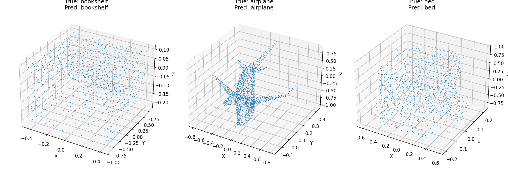
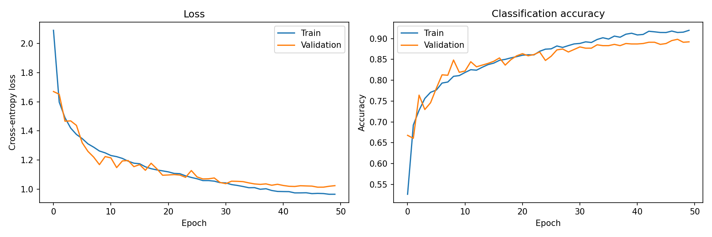
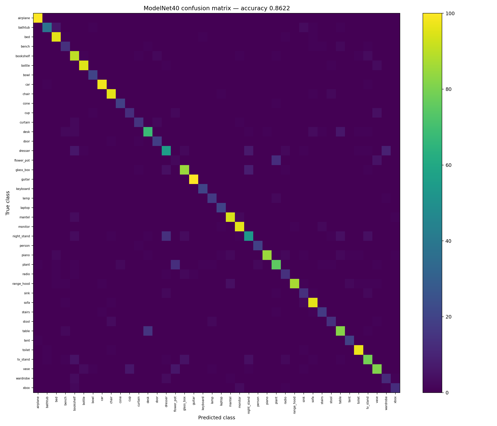

# 3D Point Cloud Classification with PointNet

PyTorch implementation of a PointNet-style classifier for ModelNet40.

<p align="center"><br>
<em>Sample ModelNet40 test objects with predicted labels.</em></p>

## What this project does

- Downloads the preprocessed ModelNet40 HDF5 dataset.
- Uses 1024 XYZ points per object.
- Trains a PointNet-style classification network with shared 1x1 convolutions.
- Uses a held-out validation subset from the official training split.
- Evaluates the best checkpoint on the official test split.
- Saves training curves, a classification report, a confusion matrix, and sample predictions.

## Project structure

```text
3d-pointcloud-classification/
├── data/
├── results/
├── src/
│   ├── dataset.py
│   ├── model.py
│   ├── train.py
│   └── evaluate.py
└── requirements.txt
```

## Install

```bash
conda activate pointcloud-env
pip install -r requirements.txt
```

## Train

```bash
python src/train.py
```

The first run downloads and extracts ModelNet40 automatically.

## Evaluate

```bash
python src/evaluate.py
```

## Outputs

```text
results/
├── best_pointnet.pt
├── history.json
├── training_curves.png
├── classification_report.txt
├── test_metrics.json
├── confusion_matrix.png
└── pointcloud_samples.png
```

## Results

| Metric | Value |
|---|---|
| Test accuracy (official ModelNet40 test split, 2,468 objects) | **86.2 %** |
| Macro F1 | 0.821 |
| Best validation accuracy | 89.8 % |
| Epochs | 50 |

<p align="center"></p>

<p align="center"></p>

## Author
Hessam Kaveh — Research Fellow, Italian Institute of Technology (IIT)

## License

Released under the [MIT License](LICENSE).
