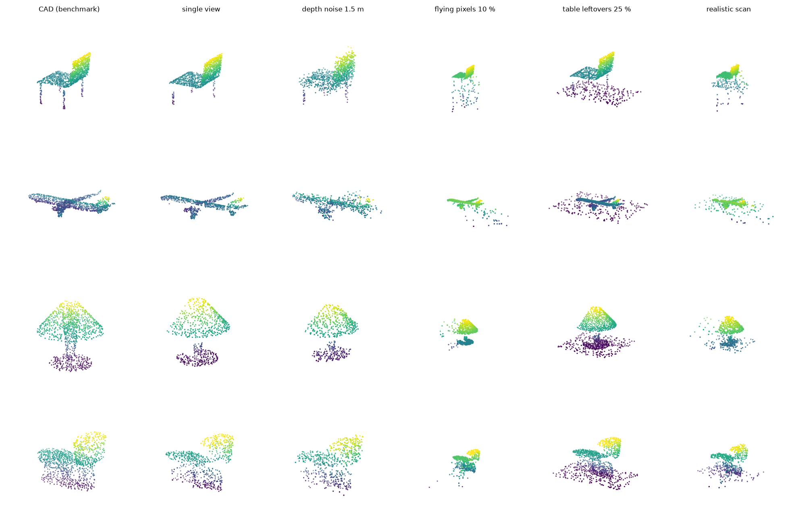
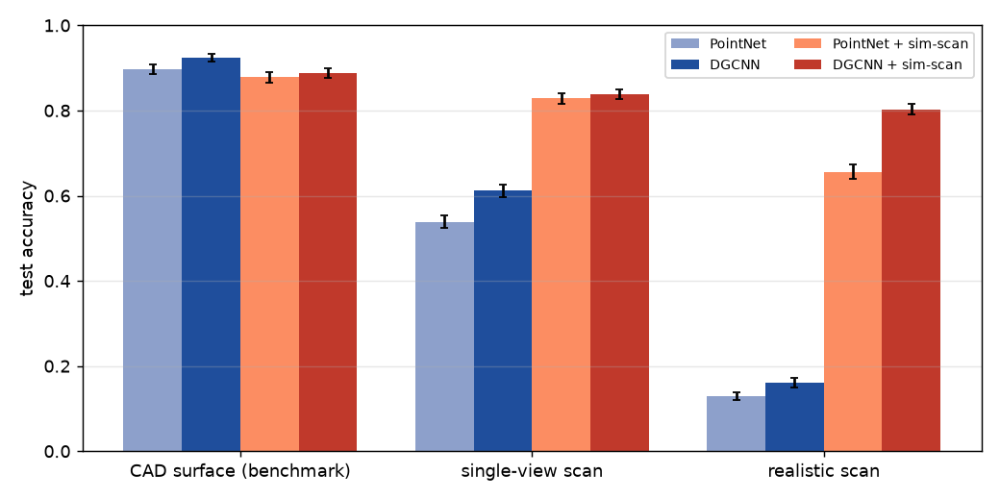
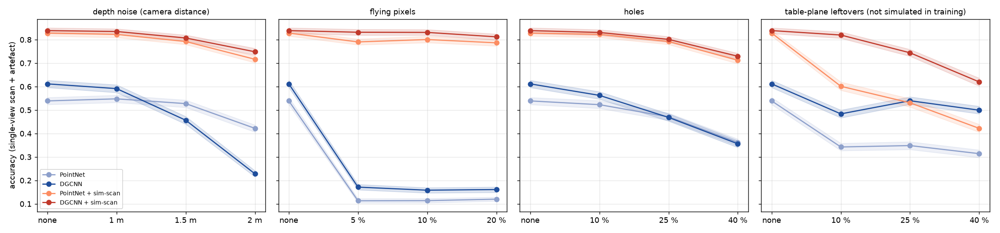
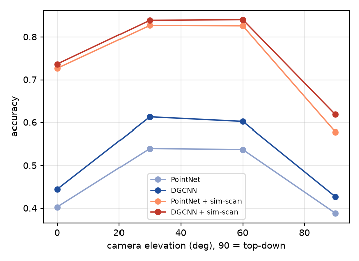
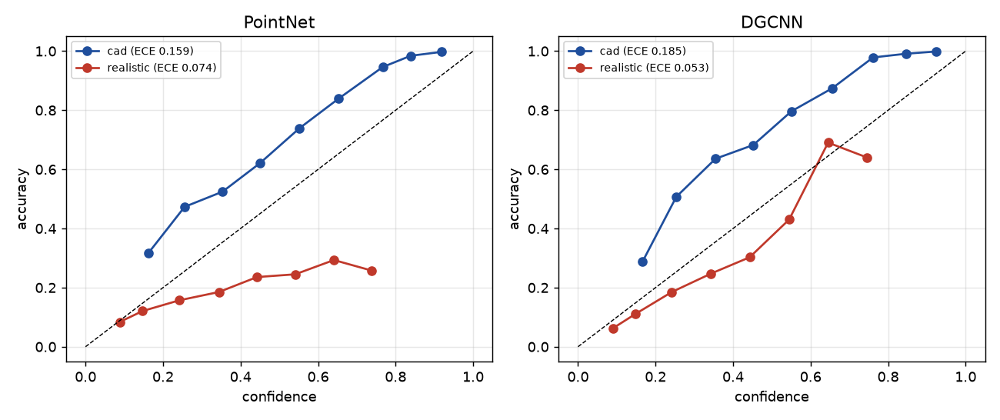
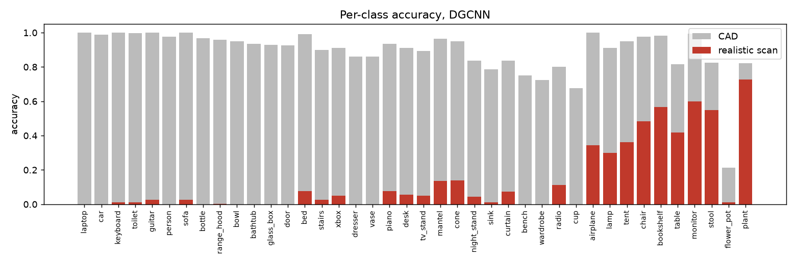

# Does a point-cloud classifier survive a real depth camera?

[](https://github.com/HessamKaveh/3d-pointcloud-classification/actions/workflows/ci.yml)   [](LICENSE) [](https://doi.org/10.5281/zenodo.24465869)

### ModelNet40 accuracy vs. what a robot's RGB-D camera actually sees

ModelNet40 is the standard benchmark for 3D object classification. Its point clouds are sampled **uniformly from the
whole CAD surface**, and published models score around 90 % on it. A robot never sees such a cloud. A depth
camera sees **one side** of the object, with depth noise that grows with distance, holes, "flying pixels" at depth
edges and leftovers of the table the object stands on.

This project measures how much of the benchmark accuracy survives that gap. It also tests what helps: a
stronger architecture, a standard outlier filter, or training on simulated scans. Two well-known architectures are
compared: **PointNet** (Qi et al., 2017) and **DGCNN** (Wang et al., 2019). Each is trained twice, once the
standard way on CAD clouds and once on simulated depth scans. All of them are then tested on the *same* objects
under 19 controlled camera conditions.


*Each row is one ModelNet40 test object, from left to right: benchmark CAD input, the side one camera sees,
depth noise at 1.5 m, flying pixels, unremoved table plane, and the "realistic" combination of all four at mild
strength.*

---

## Key findings

All numbers are on the 2,468 ModelNet40 test objects, each seen from the same 4 random azimuths (9,872 scans per
condition). Intervals are 95 % bootstrap CIs over objects.

| # | Question | Finding |
|---|----------|---------|
| 1 | **How much benchmark accuracy survives a real camera?** | Very little. DGCNN scores **92.4 %** [91.4, 93.3] on the benchmark input but **61.2 %** on a clean single-view scan and **16.1 %** [14.9, 17.1] on a realistic scan. PointNet: 89.7 → 53.9 → **13.0 %**. |
| 2 | **Which artefact hurts most?** | **Flying pixels.** Moving 5 % of the edge points backwards along the ray drops CAD-trained models to **11 to 17 %**. A few far-away points inflate the bounding sphere, so after normalisation the object shrinks to a small blob. Depth noise and holes degrade accuracy gradually. |
| 3 | **Does the better architecture help?** | On the benchmark it does: DGCNN beats PointNet by **+2.7 points** [1.8, 3.5]. Under shift the ranking is **not stable**. At 2 m depth noise DGCNN is **19 points worse** than PointNet (22.8 vs 42.2 %), because its k-NN graph is built on the noisy points. |
| 4 | **Does a standard outlier filter fix it?** | Only partly. Statistical outlier removal lifts CAD-trained models on realistic scans from 16 to **35 %** (DGCNN) and from 15 to **40 %** (PointNet). It also costs 1 to 7 points on clean inputs. Training on scans does far better. |
| 5 | **Does training on simulated scans fix it?** | Mostly. Scan-trained DGCNN reaches **80.3 %** [79.1, 81.5] on realistic scans (+64 points), and pays **3.5 points** on the benchmark. It also survives the table plane, an artefact that was **deliberately left out of the simulator** (74 % vs 54 %). Scan-trained PointNet does not (54 %). |
| 6 | **Can a confidence guarantee calibrated on CAD data be trusted on a robot?** | No. A conformal prediction set calibrated for 90 % coverage on CAD clouds covers the true class only **3.5 to 5.6 %** of the time on realistic scans with CAD-trained models, and **67 to 79 %** even with scan-trained models. Calibrating on scans restores 90 % coverage. For CAD-trained models the sets then hold ~30 of 40 classes, which makes them useless. |

---

## 1. A virtual depth camera (`src/scan.py`)

Every object is scaled to the unit sphere and treated as 50 cm across (1 unit = 0.25 m). A scan is built in
this order:

| step | model | parameter (severity 1 / 2 / 3) |
|---|---|---|
| visible side | hidden point removal from a camera at azimuth *az*, elevation 30° (Katz et al., 2007, γ = 2.6) | – |
| depth noise | Gaussian noise along the viewing ray with σ<sub>z</sub> = 0.01·z² m, like a ZED-class stereo camera | camera distance 1 / 1.5 / 2 m (σ = 1 / 2.25 / 4 cm) |
| flying pixels | silhouette points (normal almost perpendicular to the ray) pushed back along the ray by U(0, 50 cm) | 5 / 10 / 20 % of the points |
| holes | visible points removed in 3 compact patches (specular or textureless areas) | 10 / 25 / 40 % |
| table plane | points replaced by samples of the supporting plane under the object (imperfect plane removal) | 10 / 25 / 40 % |

"Realistic" is all four at mild strength (1 m, 5 %, 10 %, 10 %). Each scan is re-centred, re-scaled to the unit
sphere and re-sampled to 1,024 points, as a deployed pipeline would do with a segmented cloud. Azimuths are seeded
per object and view, so **every condition shows the models exactly the same views**, and paired comparisons are
possible.

**Scan training** (`--aug scan`) replaces 80 % of training clouds with a random scan: elevation U(−10°, 85°),
and noise, flying pixels and holes each switched on with p = 0.5 at a random strength. **The table plane is
never simulated in training**, so it serves as an unmodelled artefact at test time.

## 2. Models and training

| model | training | epochs | benchmark accuracy (this repo) | published |
|---|---|---|---|---|
| PointNet (no input/feature T-Nets), 2 seeds | CAD / scan | 150 | 89.7 % / 87.9 % | 89.2 % |
| DGCNN (k = 20), 1 seed | CAD / scan | 50 | 92.4 % / 88.9 % | 92.9 % |

AdamW (lr 1e-3, one-cycle), label smoothing 0.2, mixed precision, 1,024 points. The last epoch is used, so
there is no checkpoint selection on the test set. The PointNet numbers average two seeds, and the two seeds
agree within 0.6 points.

## 3. Results



| model | CAD (benchmark) | single view | realistic scan | realistic + outlier filter |
|---|---|---|---|---|
| PointNet | 89.7 [88.6, 90.8] | 53.9 [52.3, 55.4] | 13.0 [12.0, 13.9] | 39.8 |
| DGCNN | **92.4** [91.4, 93.3] | 61.2 [59.6, 62.7] | 16.1 [14.9, 17.1] | 34.7 |
| PointNet + sim-scan | 87.9 [86.6, 89.1] | 82.8 [81.6, 84.0] | 65.6 [64.0, 67.3] | 70.8 |
| DGCNN + sim-scan | 88.9 [87.7, 90.0] | **83.9** [82.6, 85.1] | **80.3** [79.1, 81.5] | 79.2 |

### 3.1 One artefact at a time



* **Flying pixels** are the main failure of CAD-trained models. With 10 % flying pixels, 37 % of all PointNet
  predictions become "guitar" (a thin object). Scan-trained models lose only 1 to 4 points.
* **Depth noise** hurts DGCNN more than PointNet when it is trained on CAD data. This reverses the benchmark
  ranking. A k-NN graph on noisy points connects the wrong neighbours.
* **Holes** cost both families gradually (up to 11 points for scan-trained models at 40 %).
* **The table plane** was never simulated. DGCNN + sim-scan still keeps 82 / 74 / 62 % at 10 / 25 / 40 %.
  PointNet + sim-scan falls to 60 / 53 / 42 %. This is the clearest difference between the architectures:
  DGCNN's local features generalise to a *new* artefact, while PointNet's global max-pool does not.

### 3.2 Camera elevation



All models are best at 30 to 60° and worst when looking **straight down** (90°: 39 to 62 %) or **level** with the
object (0°: 40 to 74 %). A robot arm that looks straight down at a table, which is a common setup for grasping,
is the worst case even for scan-trained models.

### 3.3 Does the outlier filter replace scan training?

`src/outlier_filter.py` applies statistical outlier removal (16 neighbours, 2 σ, as in PCL or Open3D), then
re-normalises:

| model | CAD | view | flying 10 % | noise 2 m | plane 25 % | realistic |
|---|---|---|---|---|---|---|
| DGCNN raw → filtered | 92.4 → 89.2 | 61.2 → 53.9 | 15.8 → 31.1 | 22.8 → 21.6 | 54.0 → 50.7 | 16.1 → 34.7 |
| PointNet raw → filtered | 89.9 → 89.0 | 53.8 → 50.6 | 11.1 → 28.5 | 42.2 → 46.7 | 34.9 → 41.9 | 14.5 → 39.8 |
| DGCNN + sim-scan raw → filtered | 88.9 → 87.1 | 83.9 → 81.5 | 83.1 → 81.7 | 74.8 → 70.4 | 74.4 → 77.1 | 80.3 → 79.2 |

(single seed, s0)

The filter roughly halves the damage from flying pixels on CAD-trained models, but they stay far below the
scan-trained ones (35 to 40 % vs 80 %). For scan-trained models the filter is unnecessary: it helps only on the
table plane, and it costs accuracy elsewhere.

### 3.4 Confidence: calibration, selective prediction and conformal sets



* Label smoothing makes all models **under-confident** on clean data (benchmark ECE 0.16 to 0.21). Under the
  realistic shift, confidence of CAD-trained models falls to ~0.21 on average. The model "notices" something is
  off, but this is not enough to make its predictions usable.
* Keeping only the 80 % most confident predictions on realistic scans lifts DGCNN + sim-scan from 80.3 to
  **89.1 %**. For CAD-trained DGCNN it only goes from 16.1 to 18.2 %.
* **Conformal prediction sets** (LAC, 90 % target, 200 random 50/50 calibration/test splits by object):

| model | calibrate on → test on | coverage | mean set size |
|---|---|---|---|
| DGCNN | CAD → CAD | 0.90 | 0.95 |
| DGCNN | CAD → realistic | **0.04** | 0.09 |
| DGCNN | realistic → realistic | 0.90 | **29.5** of 40 |
| DGCNN + sim-scan | CAD → realistic | **0.79** | 0.96 |
| DGCNN + sim-scan | realistic → realistic | 0.90 | **1.45** |

A coverage guarantee holds only for the data it was calibrated on. Calibrating on benchmark data and deploying on
a camera breaks it silently. With a scan-trained model and scan calibration, the result is a useful set
(1.45 classes on average) with valid coverage.

### 3.5 Which classes break



CAD-trained DGCNN, benchmark vs realistic scan, per class. Flat and thin objects that are near-perfect on the
benchmark (laptop, car, keyboard, toilet, sofa, guitar) fall to **0 to 3 %**. The classes that "survive" are mostly
the ones predictions collapse *into*: plant (82 → 73 %), stool, monitor, bookshelf, chair. A noisy blob of points
looks like a plant. High accuracy on a class under shift can therefore be an artefact of the collapse, not
robustness.

## Limitations

* **Simulated, not real, scans.** The camera model is physically motivated, but it does not replace a real
  dataset. The obvious next step is a cross-check on ScanObjectNN (Uy et al., 2019), real scans of 15 classes
  with background, which shares classes with ModelNet40.
* Simulator and test share the same family of artefacts, except for the table plane. Scan-trained results on the
  three simulated artefacts are therefore optimistic. The table-plane results are the fairer test.
* DGCNN uses one seed per training mode, because a run takes 90 minutes on a 4 GB laptop GPU. The PointNet seeds
  agree within 0.6 points, and the bootstrap CIs cover object sampling but not training randomness.
* The objects are assumed to be segmented already. Segmentation errors beyond leftover table points are not
  modelled.
* No colour. A real RGB-D pipeline could also use the image.

## Reproduce

```bash
pip install -r requirements.txt
# ModelNet40 HDF5 (2048 points + normals), e.g. from https://huggingface.co/datasets/Msun/modelnet40
export MODELNET_DIR=/path/to/modelnet40_ply_hdf5_2048

for m in pointnet dgcnn; do for a in cad scan; do
  python src/train.py --model $m --aug $a --seed 0 --epochs $([ $m = dgcnn ] && echo 50 || echo 150)
done; done
python src/train.py --model pointnet --aug cad  --seed 1 --epochs 150
python src/train.py --model pointnet --aug scan --seed 1 --epochs 150

python src/evaluate.py          # caches the 21 test conditions, writes results/results.json + figures
python src/outlier_filter.py    # results/outlier_filter.json
```

Training on an RTX 500 Ada (4 GB): PointNet ~15 to 30 min, DGCNN ~90 min per run.

```
src/scan.py            virtual depth camera (visibility, noise, flying pixels, holes, table plane)
src/data.py            ModelNet40 loading, training augmentation, seeded test conditions
src/model.py           PointNet and DGCNN
src/train.py           training
src/evaluate.py        all conditions, bootstrap CIs, calibration, conformal sets, figures
src/outlier_filter.py  statistical outlier removal baseline
```

## References

* Qi, Su, Mo, Guibas. *PointNet: Deep Learning on Point Sets for 3D Classification and Segmentation.* CVPR 2017.
* Wang, Sun, Liu, Sarma, Bronstein, Solomon. *Dynamic Graph CNN for Learning on Point Clouds.* ACM TOG 2019.
* Wu et al. *3D ShapeNets: A Deep Representation for Volumetric Shapes* (ModelNet). CVPR 2015.
* Katz, Tal, Basri. *Direct Visibility of Point Sets.* ACM TOG 2007.
* Uy, Pham, Hua, Nguyen, Yeung. *Revisiting Point Cloud Classification: A New Benchmark Dataset and Classification Model on Real-World Data* (ScanObjectNN). ICCV 2019.
* Angelopoulos, Bates. *A Gentle Introduction to Conformal Prediction and Distribution-Free Uncertainty Quantification.* 2021.

## Citation

If you use this code, please cite it (metadata in [`CITATION.cff`](CITATION.cff)):

```bibtex
@software{kaveh2026_3d_pointcloud_classification,
  author  = {Kaveh, Hessam},
  title   = {Does a point-cloud classifier survive a real depth camera?},
  year    = {2026},
  version = {1.0.0},
  doi     = {10.5281/zenodo.24465869},
  url     = {https://github.com/HessamKaveh/3d-pointcloud-classification},
  license = {MIT}
}
```

---

**Author:** Hessam Kaveh, Research Fellow, Italian Institute of Technology (IIT)

License: MIT
